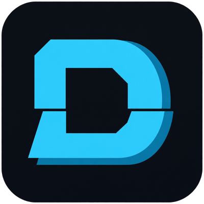

<p align="center"></p>

# DeSync UI

Сборка интерфейса для **WoW Forever** на ElvUI: готовый вид ElvUI вместе с настройками **WindTools** и **mMediaTag** и набор модулей. Выкладывается на CurseForge.

*An ElvUI-based interface pack for WoW Forever with WindTools and mMediaTag settings and a set of modules. In-game texts are in Russian.*

## Что входит в сборку

| Модуль | Что делает | По умолчанию |
| --- | --- | --- |
| Банк в сумке (`BankView`) | Кнопка в сумке ElvUI показывает содержимое банка в любом месте; банк запоминается у банкира, видны банки всех персонажей | вкл. |
| Кто кого бьёт (`TargetCount`) | В группе и рейде на индикаторах врагов: меч с числом участников, держащих врага в цели, и щит на цели танка. Только в открытом мире: в подземельях Forever игра скрывает цели от аддонов | вкл. |
| Прогресс квеста в подсказке (`QuestieTipFix`) | Возвращает строки Questie, пропадающие из подсказки моба | вкл. |
| Кто что выбрал в розыгрыше (`LootRoll`) | Счётчики и имена на кнопках «Нужно / Не откажусь / Пас» панели розыгрыша ElvUI | вкл. |
| Жезл не мешает заклинаниям (`WandStop`) | Клавиши заклинаний сначала сбивают выстрел жезлом, потом произносят заклинание (маг, жрец, чернокнижник) | выкл. |
| Кнопки у миникарты (`MinimapTidy`) | Убирает значки аддонов с миникарты в список «Модификации» | выкл. |

Плюс окно установки (на основе установщика плагинов ElvUI): создаёт профиль ElvUI «DeSync UI» из снимка вида автора. Повторно открывается командой `/desync install` или кнопкой в `/ec → DeSync UI`.

## Требования

- WoW Forever (`## Interface: 16001`)
- ElvUI — ставится вручную с [tukui.org](https://tukui.org) или через Wago / WowUp (на CurseForge его нет)
- ElvUI WindTools и ElvUI mMediaTag & Tools — обязательные зависимости (на CurseForge ставятся вместе со сборкой)
- Questie — по желанию

## Структура репозитория

```
ElvUI_DeSyncUI/          сам аддон (то, что попадает в архив для CurseForge)
  Core.lua               система модулей и страница настроек в /ec
  Installer.lua          окно установки и применение вида
  Profile.lua            снимок вида ElvUI (генерируется, руками не править)
  Modules/               модули
  Media/Logo.tga         иконка аддона (128×128, 32 бита)
tools/
  snapshot.lua           правила снимка: чистка, замены, проверка личных данных, сериализация
  export_profile.py      настройки ElvUI автора → ElvUI_DeSyncUI/Profile.lua
  build_release.py       архив для CurseForge в dist/
  migrate_author.py      разовый перенос установки автора (уже выполнен)
tests/                   тесты без игры (Lua 5.1 через lupa)
docs/curseforge/         описание страницы (ru, en) и инструкция по публикации
docs/superpowers/        дизайны и планы реализации
art/                     исходники логотипа
FishLog/, LootRollInfo/, ElvUI_MinimapTidy/   старые личные аддоны, в сборку не входят
```

## Разработка

Окружение (один раз):

```
python -m venv .venv
.venv\Scripts\python -m pip install lupa
```

Тесты — запускают все `tests/*_spec.lua` в Lua 5.1:

```
.venv\Scripts\python tests\run.py
```

Проверка в игре: скопировать папку `ElvUI_DeSyncUI` в `World of Warcraft\_forever_\Interface\AddOns\` и сделать `/reload` (новые файлы, например текстуры, игра видит только после полного перезапуска).

## Выпуск новой версии

1. Если поменялся вид ElvUI — пересобрать снимок и поднять его версию (у тех, кто поставил сборку, окно предложит «Обновить вид»):
   ```
   .venv\Scripts\python tools\export_profile.py --sv "<путь к WTF\Account\<аккаунт>\SavedVariables\ElvUI.lua>" --key "<имя профиля ElvUI>" --version <N+1> --out ElvUI_DeSyncUI\Profile.lua
   ```
2. Поднять `## Version` в `ElvUI_DeSyncUI/ElvUI_DeSyncUI.toc`.
3. Собрать архив: `.venv\Scripts\python tools\build_release.py` → `dist\ElvUI_DeSyncUI-<версия>.zip`.
4. Загрузить на CurseForge — по шагам в [docs/curseforge/publish-steps.md](docs/curseforge/publish-steps.md).

## Автовыпуск на CurseForge

Новая версия выходит по метке git: GitHub Actions (`.github/workflows/release.yml`) прогоняет тесты, собирает архив с проверкой на личные данные, загружает его на CurseForge (`tools/curseforge_upload.py`) и прикладывает к релизу на GitHub.

Один раз:
1. Токен CurseForge: [Authors Console → Settings → API Tokens](https://authors.curseforge.com/#/settings/api-tokens). В репозитории GitHub: Settings → Secrets and variables → Actions → секрет `CF_API_KEY` (или `gh secret set CF_API_KEY`).
2. Номер проекта CurseForge — строкой `## X-Curse-Project-ID: <номер>` в `ElvUI_DeSyncUI/ElvUI_DeSyncUI.toc`.
3. На CurseForge во вкладке Source выключить Automatic Packaging, чтобы версия не загружалась дважды.

Каждый выпуск: поднять `## Version` в `.toc` (и снимок вида, если он менялся), закоммитить и отправить метку:

```
git tag v1.0.1
git push origin v1.0.1
```

Метка должна совпадать с `## Version`, иначе выпуск остановится. Версия игры берётся из `## Interface` (16001 → 1.60.1, WoW Forever), WindTools и mMediaTag отмечаются как обязательные зависимости.

## Защита от утечки личных данных

- Снимок вида собирается только из профиля, личных настроек ElvUI и масштаба интерфейса. Экспорт падает, если в снимке нашлись имена, сервер, GUID, следы MerathilisUI или любой не-латинский текст, и если файл не загружается обратно в точности.
- Архив собирается только из разрешённых типов файлов (`.lua`, `.toc`, `.xml`, текстуры, шрифты, звуки) и проверяется на те же стоп-слова; посторонний файл останавливает сборку.
- Личные стоп-слова (сервер, номер аккаунта) лежат в локальном `tools/stopwords.local.txt` — по слову в строке; файл не попадает в git, инструменты подмешивают его сами.
- `backups/`, `dist/`, `.venv/` и `tools/stopwords.local.txt` в репозиторий не попадают.
